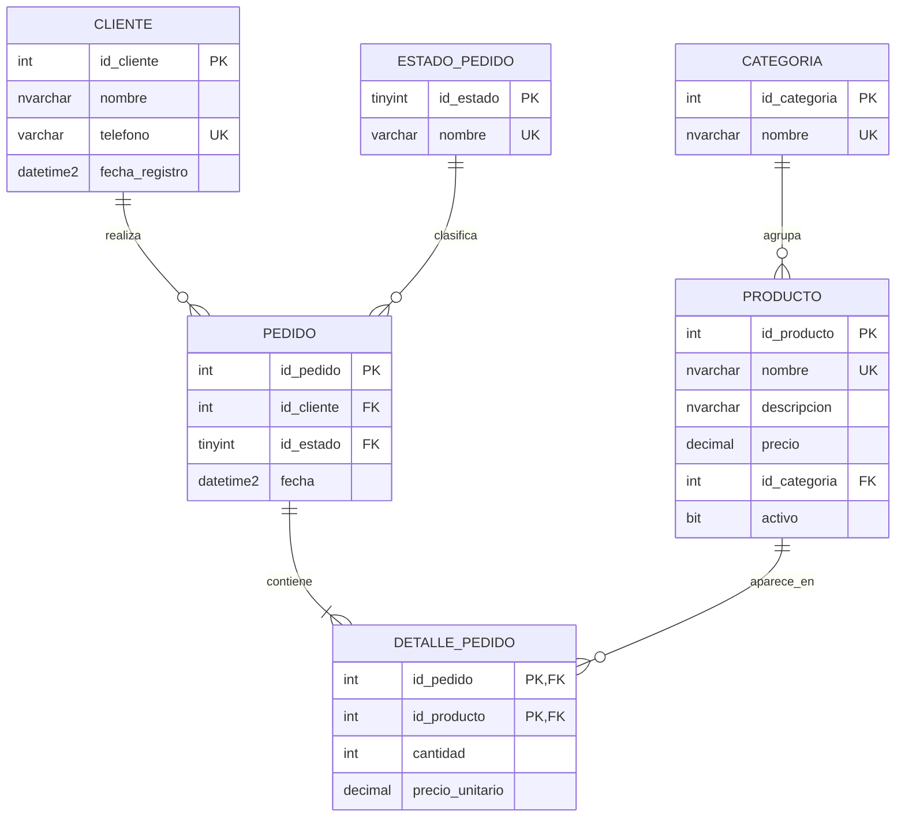

# Diagrama Entidad-Relación – Sistema de Pedidos de Café

## Cardinalidades

| Relación | Cardinalidad |
|---|---|
| Cliente – Pedido | 1:N |
| Categoría – Producto | 1:N |
| Estado_Pedido – Pedido | 1:N |
| Pedido – Producto | N:M, resuelta con `Detalle_Pedido` (PK compuesta `id_pedido, id_producto`) |
